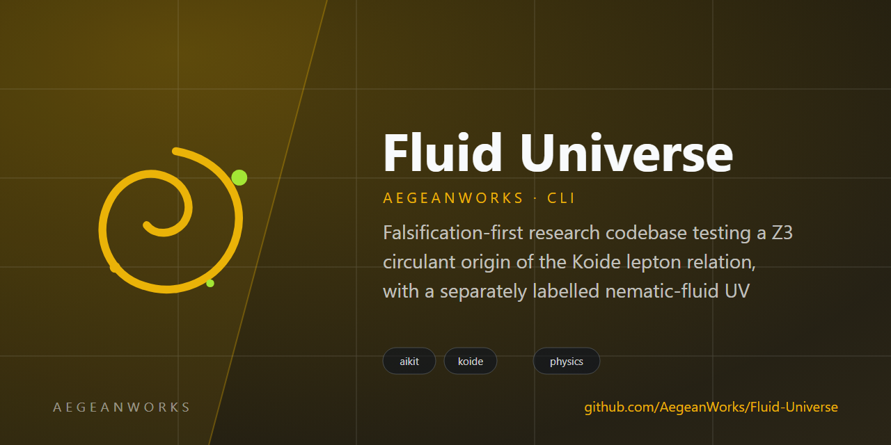

# fluid-universe

<!-- aegean:media:start -->
<p align="center"></p>
<p align="center"><a href="LICENSE"></a> <a href="https://github.com/AegeanWorks/AIKit"></a></p>
<!-- aegean:media:end -->


Falsification-first research codebase testing a Z3 circulant origin of the Koide lepton relation, with a separately labelled nematic-fluid UV speculation.

**Epistemic status (2026-10-25):** the algebra is verified and is likely known (Brannen 2006). The Z3/circulant structure by itself does **not** predict the Koide value; it has three parameters for three masses, and Koide is the extra condition \(|c|/a=1/\sqrt2\). The exact one-loop statement "\(|c|/a\) is RG-invariant" is false, although the numerical drift for charged leptons is only about \(3\times10^{-6}\) over 16 decades. The nematic-fluid UV track has **no** validated calculation yet and is kept in a separate, clearly speculative section.

## 30-Second Cold-Start Quick Reference

- **Runtime Prerequisites**: Python 3.10 or newer; `numpy`, `scipy`, `sympy`, `jax`; `pytest` and `hypothesis` for the test suite.
- **Install**: `python -m pip install -e ".[dev]"`
- **Canonical Regression Shield Gate**:
  ```bash
  python -m pytest -q
  ```
- **Regenerate every number**:
  ```bash
  python -m phenomenology.run_all
  ```
  This writes `results/pdg_fit.json`, `results/pdg_fit.md`, `results/rg_run.json`, `results/rg_run.md`, `results/rotor.json`, `results/rotor.md`, `results/neutrinos.json`, `results/neutrinos.md`, `results/quarks.json`, `results/quarks.md`, `results/pmns.json`, `results/pmns.md`, `results/delta_search.json`, `results/delta_search.md`, `results/frank_oseen.json`, `results/frank_oseen.md`, `results/derrick.json`, `results/derrick.md`, `results/topology.json`, `results/topology.md`, `results/reduction.json`, `results/reduction.md`, `results/predictions.json`, `results/predictions.md`, `results/lorentz.json`, `results/lorentz.md`, `results/sim_core.json`, `results/sim_core.md`, `results/hopf.json`, `results/hopf.md`, `results/hopfion.json`, `results/hopfion.md`, `results/hopfion3d.json`, `results/hopfion3d.md`, `results/hopf_resolution.json`, `results/hopf_resolution.md`, and `results/summary.md`, each with a config hash, package versions, and git commit (or `dirty`).
- **Verify every claim independently (two runs)**:
  ```bash
  python -m verification.verify
  # or, where make is installed:
  make verify
  # explicit steps, always two separate processes:
  python -m verification.audit --tag run1
  python -m verification.audit --tag run2
  python -m verification.compare
  ```
  This regenerates the physics outputs, runs the audit in two separate processes, and compares the per-claim results. The audit re-derives every PROVEN, VERIFIED, or NUMERIC claim without importing the project modules. Project rule G-001: every claim is verified twice, in two separate processes, and the results must agree; a single run is not accepted. This applies to claims, not to the pytest suite. The combined result is `results/verification.{json,md}`; a bare `python -m verification.audit` writes `verification_single.*` and is marked NOT ACCEPTED.
- **Claim audit status**: two separate runs agree per claim, 218/218 checks each (`python -m verification.verify`).
- **Read the ledger first**: [`claims.md`](claims.md), [`SCORECARD.md`](SCORECARD.md), [`CHANGELOG.md`](CHANGELOG.md), [`theory/formulas.md`](theory/formulas.md).

### AIKit Commands (run from the AIKit folder)

| Role | Command |
|---|---|
| Status, task and gates | `python aikit.py status fluid-universe` |
| Phase 4: every gate | `python aikit.py check fluid-universe` |
| Repair memory and map, then check | `python aikit.py fix fluid-universe` |
| Resume an interrupted task | `python aikit.py resume fluid-universe` |

## What Is Actually Established

| Item | Verdict | Where |
|---|---|---|
| Hermitian circulant \(M=\mathrm{circ}(a,ce^{i\delta},ce^{-i\delta})\) has eigenvalues \(a+2c\cos(\delta+2\pi k/3)\) and DFT eigenvectors independent of \(\delta\) | PROVEN; likely known | `theory/circulant.py`, `tests/test_circulant.py` |
| \(Q=\sum m/(\sum\sqrt m)^2=1/3+2c^2/(3a^2)\) for the signed eigenvalues | PROVEN, with a positivity condition; likely known | `theory/formulas.md` F1-F3 |
| \(Q=2/3\) iff \(\lvert c\rvert/a=1/\sqrt2\) | PROVEN algebra; NOT a prediction of Z3 alone | `claims.md` 1a/1b |
| Pole-mass fit and uncertainty propagation | NUMERIC | `phenomenology/fit.py`, `results/pdg_fit.json` |
| \(Q=2/3\) for MS-bar masses at \(M_Z\) | FALSIFIED: \(Q(M_Z)\approx0.6678\) | `results/rg_run.json` |
| \(\lvert c\rvert/a\) exactly RG-invariant at one loop | FALSIFIED; drift is numerically tiny | `phenomenology/rg.py`, `results/rg_run.json` |
| Rotor spectrum and free-rotor limit | PROVEN numerically | `theory/rotor.py`, `results/rotor.json` |
| Rotor \(\to\) three distinct masses | FALSIFIED: sectors 1 and 2 are exactly degenerate | `results/rotor.json` |
| Domain-wall tension \((8/3)\sqrt\mu\) | PROVEN | `results/rotor.json` |
| Closed form for \(\delta\) | UNVERIFIED (null): 2/9 at 0.407\(\sigma\), look-elsewhere \(p=7.9\times10^{-4}\), not promoted | `results/delta_search.json` |
| Frank-Oseen equal-\(K\) dispersion | PROVEN for that statement only: 2 transverse modes, no photon | `results/frank_oseen.json` |
| Derrick scaling | PROVEN: \(d=3\) exponents \((1,-1,3)\), virial \(E_2-E_4+3V=0\) | `results/derrick.json` |
| Stable Hopfion existence | UNVERIFIED; \(\kappa>0\) is necessary, not sufficient; both tested candidates are saddles (14d, 14e), a saddle-escape search collapses to H=0.24-0.32, and a length scan 8-14 is a saddle at every length | `results/derrick.json` |
| Finite-energy H=1 configuration | NUMERIC: \(E_2=233.6\), \(E_4=159.3\), \(H=1.000000\), \(\lambda^*=0.82563\); no stability proof | `results/hopfion.json` |
| Pure-FN H=1 candidate | N=64, force RMS 0.00315, \(H=0.99999993\); near-stationary, not a stability proof | `results/hopfion3d_n64.json` |
| Scale-stationary H=1 candidate | NUMERIC candidate: virial 0.00961, \(H=0.99730\), RMS 0.0030 | `results/hopfion_scale.json` |
| Stability of the scale candidate | FALSIFIED: validated tangent Hessian, min \(-5.799863\) with 8 negative modes at N=64; the candidate is a saddle | `results/hopfion_stability.json` |
| Stability of the pure-FN candidate | FALSIFIED: min \(-2.600799\) with 8 negative modes at N=64; the near-stationary H=1 candidate is a saddle | `results/hopfion_purefn_stability.json` |
| 2D reduction lower bound | PROVEN (trivial): \(E_{2D}\ge T L_y\); equality only for \(y\)-independent walls | `results/reduction.json` |
| Exact reduction / finite \(I_{\rm eff}\) | FALSIFIED: \(1/r^4\) tail gives log-divergent \(I_{\rm eff}\) | `results/reduction.json` |
| Z3 from nematic topology | FALSIFIED: \(RP^2\) has no Z3 factor; \(\cos3\phi\) inserted by hand | `results/topology.json` |
| New prediction beyond Koide | UNVERIFIED (none found): seven candidate classes audited | `results/predictions.json` |
| Vortex-knot mass spectrum | FALSIFIED: \(m\propto E(T(2,n))\) gives 1:1.44:1.94 and \(Q=0.339\); observed 1:206.8:3477 and \(Q=2/3\); needs \(m\propto E^{12.3}\) or an exponentially small core | `results/vortex_knot_spectrum.json` |
| One-parameter vortex hierarchy | FALSIFIED: geometric cascade predicts tau 11.3\(\times\) high; power law fits either the muon ratio (+34.5% tau) or \(Q\) (-32.5% tau), not both | `results/vortex_cascade.json` |
| Real Z3 rotor potential | FALSIFIED: real potential keeps \(E_1=E_2\) at zero flux; second harmonic plus flux gives max \(Q=0.3376\), not \(2/3\) | `results/rotor_potential.json` |
| Madelung fluid dictionary | NUMERIC: QM is exactly continuity plus Euler with a quantum pressure; free Gaussian \(L^2=8.8\times10^{-13}\), coherent state \(1.2\times10^{-4}\), continuity \(3.3\times10^{-7}\), Euler \(6.1\times10^{-3}\); not a microphysical derivation | `results/madelung.json` |
| Nelson stochastic kinematics | NUMERIC: \(D=\hbar/(2m)\) osmotic drift reproduces the ground state (variance 0.500625, \(L^1=0.0177\)) and free packet (\(L^1=0.0195\)); exact-density drift, so a consistency check | `results/nelson.json` |
| Gaussian Madelung reduction | PROVEN: the Gaussian ansatz gives the Ermakov equation; its fixed point is \(\sigma^2=\hbar/(2m\omega)=0.5\), with energy drift \(2.8\times10^{-12}\) and period \(3.141600\) vs \(\pi\) | `results/gaussian_fluid.json` |
| Moving-center Gaussian | PROVEN: the displaced Gaussian decouples into \(x_0''=-\omega^2x_0\) and the Ermakov width; center period 6.284000 vs \(2\pi\), width error 0, energy drift \(7.1\times10^{-15}\) | `results/coherent_fluid.json` |
| First excited state node | FALSIFIED: density vanishes at \(x=0\), phase jumps by \(\pi\), and the phase-gradient maximum scales as \(dx^{-1}\); the regular \(Q\) matches away from the node, but the node is a phase slip | `results/excited_fluid.json` |
| Hydrogen 1s reduction | PROVEN: the Coulomb potential and quantum pressure balance at \(a_0=\hbar^2/(me^2)=1\), with \(E=-0.5\); SI \(a_0=5.291773369\times10^{-11}\) m, \(E=-13.605687\) eV | `results/hydrogen_fluid.json` |
| Hydrogen 2p vortex | NUMERIC: \(2p_{m=\pm1}\) has circulation \(2\pi\), axial angular momentum 1, most-probable radius \(4a_0\) and normalized radial density; \(m=0\) has no vortex | `results/hydrogen_vortex.json` |
| Shallow-water acoustic horizon | PROVEN: \(h=0.1\) m, \(Q=10^{-3}\) m³/s gives \(c=0.990454\) m/s, \(r_H=1.606888\times10^{-3}\) m, \(\kappa=610.497\) m/s², \(T_H=7.422\times10^{-10}\) K; \(g_{tt}=0\) at the horizon; long-wavelength only | `results/water_analogue.json` |
| Capillary validity | PROVEN: \(\ell_c=2.726879\times10^{-3}\) m; the lab \(r_H\) is capillary-dominated (ratio 2.8798); \(r_H\ge10\ell_c\) requires \(Q\ge1.697\times10^{-2}\) m³/s; \(Q=0.05\) gives ratio \(1.152\times10^{-3}\) | `results/water_validity.json` |
| Dispersive water horizon | PROVEN: \(\omega_c=84.824\) rad/s; horizon ratios 1.000013 at 0.1 rad/s, 1.151520 at 10, 5.192407 at 100; long-wavelength metric valid below about 1 rad/s | `results/water_dispersive.json` |
| Radial ray separatrix | PROVEN: outgoing speed changes sign at \(r_H\) (\(-0.110\) at 0.9\(r_H\), \(+0.090\) at 1.1\(r_H\)); ray times match analytic to \(2\times10^{-6}\); peeling rate 12.209936 equals the surface gravity | `results/water_rays.json` |
| 1D horizon scattering | NUMERIC: the horizon transmits \(7.503\times10^{-6}\) of the packet energy (center \(-1.433\) m); the uniform control transmits 1.000000 (center 4.433 m) | `results/water_scattering.json` |
| Hydrated-electron cavity | NUMERIC: surface tension plus quantum pressure gives \(R=2.858\) Å and \(E=0.933\) eV vs observed 1.7 eV (factor 1.8); screened hydrogen is \(41.5\) Å and \(-2.2\) meV, ruled out | `results/water_electron.json` |
| Finite-well test | NUMERIC (negative): the Born-depth well at \(R=2.858\) Å binds only 1s; the maximum Born-depth s->p gap is 0.615 eV; a 1.7 eV gap needs 3.715 eV at \(R=3.181\) Å (1.481 eV above Born) | `results/water_well.json` |
| Bound-free finite well | NUMERIC: the Born-depth continuum peaks at 1.023 eV (TRK sum rule 0.986), not 1.7 eV; a 1.7 eV peak needs an extra 1.202 eV of depth (V0=3.689 eV), 0.869 of the optical reorganization energy | `results/water_absorption.json` |
| Emergent metric at tree level | FALSIFIED: preferred frame; no metric; \(\xi=1.00348\) for \(K=(1,2,3)\) | `results/lorentz.json` |
| One-loop RG to a Lorentz-invariant IR | UNVERIFIED: no calculation | `results/lorentz.json` |
| Photon LV bounds on director modes | UNVERIFIED (not applicable): modes are neutral | `results/lorentz.json` |
| 1D simulation baseline | PASS: kink, gradient, monotone flow, rotor; Hessian partial | `results/sim_core.json` |
| Hopf preimage linking | PASS: H=0.999958 at 400 samples; reflection flips sign; rotation/shear invariant | `results/hopf.json` |
| Hopf grid Chern-Simons estimator | PASS (normalized): 1.000000 at N=64; agrees with preimage | `results/hopf.json` |
| Hopf grid resolution | N>=32 within 1e-3; N=16/24 under-resolved | `results/hopf_resolution.json` |
| 3D E2+E4+Z3 pilot | UNVERIFIED: N=32 not converged/resolution-limited; H/Z3 vary with steps; no conclusion | `results/hopfion3d.json` |
| N=64 3D diagnostic | Targeted, not part of `make results`: `make n64`; H falls below 0.8 as Z3 exceeds 0.6; no coexistence; not converged | `results/hopfion3d_n64.json` |
| N=64 candidate Hessian | Targeted, not part of `make results`: `make stability`; dense-validated tangent operator; min \(-5.799863\), 8 negative modes; saddle | `results/hopfion_stability.json` |
| 3D Hopfion + Z3 order | UNVERIFIED: N=64 production scan (`make production`, <15 min G-003) gives native H=0.7880, 2x upsampled H=0.9892, Z3=0.6074, max bond 1.480, min pre-norm 1.000000; native H drop is an estimator artifact; not converged/under-resolved | `results/hopfion3d_production.json` |
| N=96 resolution check | UNVERIFIED: at the same physical time (3000 steps), native H=0.99994 and upsampled H=1.00000, but Z3=0.17207 and force RMS 0.01495; the N=64 Z3 order is not spatially converged, so no coexistence is demonstrated | `results/hopfion3d_convergence.json` |
| N=64 dt check | PASS: 3000 steps at dt=5e-4 versus 6000 at dt=2.5e-4, both at t=1.5, give ΔH=-1.07e-4 and ΔZ3=-4.6e-6; the N=96 Z3 gap is not a timestep artifact | `results/hopfion3d_temporal.json` |
| N=96 checkpointed extension | UNVERIFIED: four 3000-step chunks to t=6.0; Z3 rises 0.172→0.599 and crosses 0.5, but native H falls to 0.97262, max bond rises to 0.857 and force RMS is 0.01075; H, force and resolution criteria fail | `results/hopfion3d_extension.json` |
| Neutrino \(Q_\nu\) for both orderings | NUMERIC negative: max \(0.585612\), never \(2/3\) | `results/neutrinos.json` |
| Minimal circulant PMNS branches | FALSIFIED: both no-mixing and trimaximal branches excluded | `results/pmns.json` |
| Direct quark Koide extension | FALSIFIED: \(Q_U\approx0.888\), \(Q_D\approx0.748\) at \(M_Z\) | `results/quarks.json` |
| Nematic-fluid UV picture | SPECULATION; structural F-O/Derrick checks only | `sims/README.md` |

## What's Inside

```text
fluid-universe/
├── .aikit/                   <- project memory: ledger and decisions
├── .gitignore                <- transient AIKit state excluded
├── COMMERCIAL.md             <- commercial licensing terms
├── LICENSE                   <- Aegean Science License 1.1 (ASL-1.1): free non-commercial research
├── LICENSES/                 <- REUSE license texts
├── REUSE.toml                <- Machine-readable SPDX metadata
├── ASSETS.md                 <- Asset/data manifest: what the license covers
├── assets/                   <- brand artwork and social preview
├── README.md
├── Makefile                  <- test, results, and two-run verification targets
├── pyproject.toml            <- dependencies and pytest configuration
├── claims.md                 <- claim ledger with statuses and kill tests
├── CHANGELOG.md              <- append-only corrections and retractions
├── SCORECARD.md              <- one-line status per claim
├── theory/                   <- symbolic algebra, formula registry, literature notes
├── phenomenology/            <- PDG data, circulant fit, one-loop SM RGE
├── tests/                    <- pytest identities, limits, regression numbers
├── verification/             <- independent re-derivation of verified claims
├── sims/                     <- validated 1D core and bounded 3D diagnostics
├── paper/                    <- two LaTeX documents, separate scopes
└── results/                  <- machine-generated outputs only
```

## Conventions and Non-Negotiables

- Every number in prose must regenerate from `python -m phenomenology.run_all`; the JSON records seed, config hash, package versions, and git commit.
- Labels: **derived**, **assumed**, **analogy**, **speculation**. A numerical fit is not a derivation.
- No production 3D simulation number is cited until `sims/core.py` passes the full baseline set in `sims/README.md`. Earlier lost-run numbers (\(|H|\sim0.16\), \(Z_3\sim0.72\), \(N=36\)) are **not** used.
- Negative results are kept. Corrections go to `CHANGELOG.md`; they are not silently edited.
- The Z3/Koide/RG paper must stand without any fluid-universe material.

<!-- aegean:brand-assets:start -->
## 🎨 Brand Assets

> **AI-Generated Brand Artwork.** The banner and logo are **AI-generated brand assets**. They are illustrative and may not literally depict every feature or the full project scope.
<!-- aegean:brand-assets:end -->

## 📜 License

Free for non-commercial research and teaching under the Aegean Science License 1.1 (ASL-1.1); see [LICENSE](LICENSE). It allows publication, reproducibility sharing, text/data mining and non-commercial ML training. Commercial or industry-sponsored use needs the Aegean Commercial License 1.0 (ACL-1.0); see [COMMERCIAL.md](COMMERCIAL.md).
